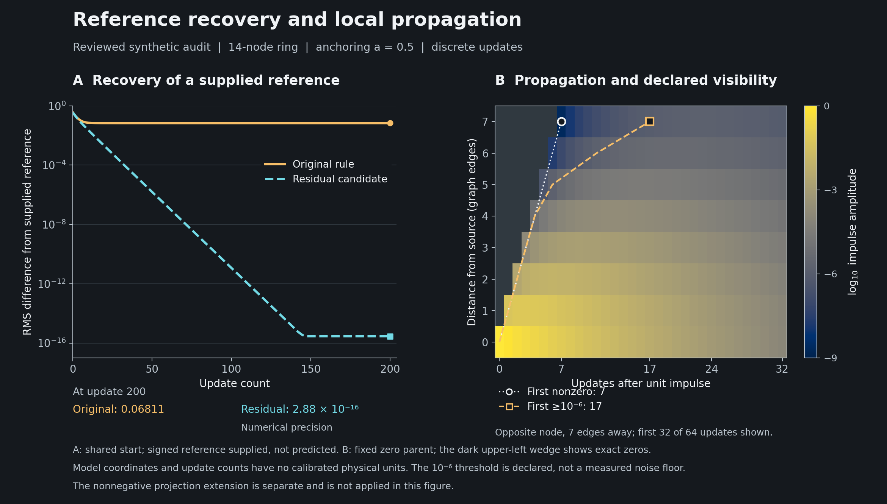

# TORUS/TLD resonance, causality and observer-state research

Date: 23 November 2026.

Read [the research report](report/RESEARCH_REPORT.md) for the findings, reasoning
and limits. [The failure playbook](report/FAILURE_PLAYBOOK.md) records the causes,
repairs and detection checks that future work should retain.



## What this package contains

- `archive/`: public-safe historical recovery, exact source-line anchors and hashes.
- `research/`: primary-source review, independent derivation and publication checks.
- `dynamics/`: frozen local-operator experiment, numerical results, independent
  reviewer and the separately frozen admissibility repair.
- `causal/`: finite reaction-model observation/history experiments, witnesses,
  policies, independent checks and portable replay.
- `report/`: integrated interpretation, boundary reviews and figures with source data.

These are source-linked research findings and exact or numerical results for
declared models. They do not establish a uniquely required fourteen-layer
architecture, measured human/artificial observer resonance or biological
predictive superiority. The supplied parent references, iteration clocks,
measurement floors and intervention sets remain explicit assumptions.

Private conversations and raw archive search material are excluded. Their public
ledgers identify originals by title, hash and physical line range; reviewing those
original passages requires separately authorized archive access. The included
numerical experiments can be reproduced from the packaged inputs.

## Verify before running

```sh
python verify_package.py
```

This checks all packaged payload bytes, all three frozen specifications and the
nested custody manifests. It does not rerun scientific calculations. `MANIFEST.json`
does not contain a hash of itself; retain its SHA-256 from external custody when
checking a downloaded copy.

The package-local `.gitattributes` preserves exact bytes on Git checkout, including
Windows. Keep the complete directory structure when downloading or copying.

## Reproduce the scientific computations

The tested interpreter is CPython 3.12.14. The main operator experiment and its
reviewer use NumPy 2.3.5. The causal replay and exact admissibility extension use
only the Python standard library. `ENVIRONMENT.json` records the build environment
and the installed figure-generation version separately.

```sh
python -m pip install -r research/requirements-reproduction.txt
python research/reproduce_public_package.py --output-dir ../torus_resonance_reproduction_2026_11_23
python causal/verify_replay.py
```

Use a new output destination. The first wrapper preserves original results and
runs the local dynamics, independent review and admissibility extension in the
new directory. The causal wrapper uses a temporary copy, compares scientific
fields and preserves the packaged evidence. Timestamps change during replay.

For a preparation-only check, append `--prepare-only` to the dynamics wrapper.
See [figure documentation](report/figures/README.md) for plot regeneration and
data provenance. The packaged PNG and SVG can be viewed without Matplotlib.

The saved independent reviews are separate checking implementations within this
research effort. They are not external peer review or empirical replication.
