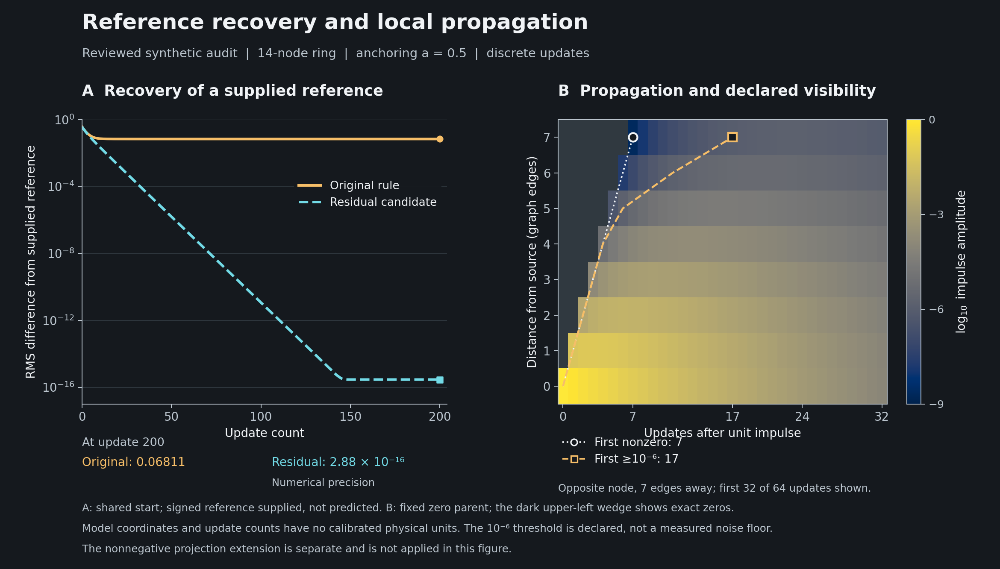

# Coupling, observation history and boundary-dependent closure

## TORUS / TLD / ControllerGate research continuation — 23 November 2026

**Status:** completed archival recovery, exact finite-model analysis, source-based numerical experiments and explicitly scoped repairs. This report strengthens several operational claims within the tested models. It does not establish a unique fourteen-layer physics, biological predictive superiority, consciousness as a physical generator, or a universal theory of reality.

## 1. Outcome and scope

The emphasis on systems resonating together and observers participating in causal chains has a real basis in the recovered TORUS record. The constructive response is to specify the interaction, observation and memory mechanisms and then test what they preserve. This pass made that specification more concrete in two existing computational settings.

The selected ControllerGate reaction model now has an exact account of what can be learned from a snapshot, from a sequence of chosen actions, and from action-status records. It contains a useful counterexample: every pair of states can be distinguished by some experiment, yet no single adaptive experiment guarantees identifying an unknown starting state through the external-lactate readout alone. Recording PASS/BLOCK repairs that failure. The same model also demonstrates a nontrivial predictive quotient whose validity changes when the allowed environmental interventions expand.

The actual Field Studio update now has an explicit optimization interpretation. Its stability can coexist with a persistent error relative to a supplied nonuniform reference because smoothing and exact reference agreement are competing objectives. A residual-coupling candidate removes that particular conflict. A separately frozen review then exposed and repaired its failure to preserve nonnegative coordinates. Both the original limitation and the new repair's constraints remain in the record.

These are applications and model-specific developments of established mathematics. The original source, specifications, results, corrections and reproduction paths are retained. No new historical notebook execution, live PC inspection, production deployment or live Command Center inspection is claimed.

## 2. What was recovered, including later repairs

The public archive ledger contains 24 paraphrased anchors tied to 12 hashed sources and their physical line spans. A targeted continuation search covered 222 content-unique files. It is a documented search of accessible material, not a claim that every private archive or missing notebook has been exhaustively inspected. See [the chronology](../archive/PUBLIC_RESONANCE_HISTORY.md), [anchor ledger](../archive/PUBLIC_RESONANCE_LEDGER.json), [source identities](../archive/PUBLIC_RESONANCE_SOURCES.json) and [coverage](../archive/PUBLIC_SEARCH_COVERAGE.json).

The historical program uses resonance for several related but distinct targets:

| Target | Operational meaning | Evidence needed |
|---|---|---|
| Structural compatibility | Several constraints can be satisfied or improved jointly | Explicit objective, residuals and feasible set |
| Preferred structural basin | A specified score is better at a particular architecture or scale | Comparable models, normalization and competing sizes |
| Phase or frequency locking | Relative phases or frequencies remain appropriately coordinated | Time series, phase definition and coupling controls |
| Driven resonance | A specified response peaks as forcing frequency changes | Response curve and competing explanation |
| Observer-relative predictive closure | Hidden differences do not change the relevant future under allowed actions | State-equivalence or prediction/intervention test |

Archive 9 describes reciprocal S/R/G roles and proposes a one-cycle Jacobian. It also explicitly treats the controller as nonadditive; invoking the upper roles does not automatically add a fifteenth physical direction. This preserves the intended functional architecture. It does not supply all state spaces and executable maps needed for a full controller-stability theorem.

The original determinant-phase proposal, `arg det(I-J)`, was already corrected in Sweep 5. For a real Schur-stable matrix, real eigenvalues contribute positive factors to `det(I-J)` and complex-conjugate pairs contribute positive squared magnitudes. The determinant is positive and its pointwise argument is zero. This pass credits that later correction. It also preserves the distinction between spectral radius, matrix norm and a feedback phase margin.

Archive 12 contains a structural-resonance definition using an interior RMS minimum and a coupled quadratic chain objective. The Field Studio update belongs to a related quadratic family, but uses a periodic ring and a parent anchor. It is not the identical historical objective. Sweep 6 had already established its spectrum and fixed-point behavior; those results are recovered foundations, not new discoveries here.

Later PHASE_V2 work implemented complex winding with abstention, explicit O(2) transport and temporal cross-spectrum/uncertainty tools. It therefore cannot fairly be dismissed as permanently conceptual. Its subsequent uncertainty gate also remains material: nominal 95% phase intervals covered 456/512 and 470/512 cases in the reported calibration checks, and the later prospective status was `NOT_RUN_METHOD_UNCERTAINTY_GATE_FAILED`. Implemented measurement tools and a failed calibration gate can both be true.

## 3. An observer inside the causal system

A useful general formulation contains system state `x`, environment state `e`, observer memory `m`, an observation map `h` and a policy `pi`:

\[
y_t=h(x_t,e_t),\qquad a_t=\pi(m_t),
\]
\[
x_{t+1}=F(x_t,e_t,a_t),\quad
e_{t+1}=G(e_t,x_t,a_t),\quad
m_{t+1}=U(m_t,a_t,y_{t+1}).
\]

This is a modeling template, not a newly measured law. It makes the observer's causal participation explicit: the state influences the record, the record influences the chosen action, and the action changes subsequent state. A reported experience can be represented as another output of the observer model. That alone does not identify the physical origin of all reality or human consciousness.

The executed ControllerGate model instantiates a finite version. Its six curated reaction requests have explicit enabling conditions. A valid request updates the material state and returns PASS. An invalid request preserves the state and returns BLOCK. These are untimed commands, not measured biological reaction rates.

The observer retains a set `B` of states still compatible with its record. For action `a` and observed response `r`,

\[
B_{t+1}=\{F_a(x):x\in B_t,\ R_a(x)=r_t\},\qquad a_t=\pi(B_t).
\]

Identifying the original state additionally requires retaining original-state labels through the history. A controller can force distinct origins into the same current state without learning which origin occurred. The new analysis explicitly separates current-state homing, initial-state identification and predictive-class homing.

### 3.1 Exact execution and positive result

Transition semantics and reachable graphs were independently reconstructed from the frozen reaction contract. The two original reachable graphs reproduced as 18 states/58 enabled edges and 6 states/10 enabled edges. All eight subsets of GA3P, pyruvate and external-lactate readouts were analyzed with and without status recording. An empty observer was included as a negative control. This is not a second independent transcription of the original Reactome records.

With all catalytic roles fixed and known, each nonempty single readout has 18 or 6 distinct future-behavior classes even though its snapshots alias several states. With a single readout plus PASS/BLOCK records, adaptive policies guarantee identifying the initial state within these worst-case command counts:

| Readout plus action status | 18-state graph | 6-state graph |
|---|---:|---:|
| GA3P | 3 | 2 |
| Pyruvate | 3 | 2 |
| External lactate | 4 | 3 |

The exported GA3P/status policy for the 18-state graph and external-lactate/status policy for the six-state graph were replayed from all 24 starting states. Both selected policies require at most three commands. The saved policy file contains every action, response and surviving hypothesis.

This is more than a resemblance: a declared memory/interaction mechanism repairs a specific ambiguity. It does not show that every observer can reconstruct arbitrary hidden state, or that the selected three readouts are uniquely necessary.

### 3.2 A precise failed inference and its repair

In the six-state graph, external lactate without status has six distinct future-behavior classes. Every pair of states can therefore be separated by some action sequence. Nevertheless, from the ambiguous zero-lactate observation there is no finite adaptive strategy guaranteed to identify the original state.

The preserved impossibility certificate has two relevant beliefs. From `{0,1,3,4,5}`, the zero-lactate export outcome can leave `{0,1,4,5}`. Within that trap, four requests can merge different origins with the same readout, and the two transport requests are uninformative. Every policy therefore has at least one possible outcome that destroys or indefinitely fails to obtain the needed distinction.

PASS/BLOCK preserves a distinction that the material successor alone erases. Recording it restores a guaranteed three-command initial-identification strategy. A third implementation independently retained explicit original-to-current labels and reproduced this conclusion without importing either of the two experiment implementations.

This distinction has established automata-theory precedents; Moore's 1956 chapter explicitly separates pairwise distinguishability from initial-state identification. The new contribution here is its exact occurrence, certificate and repair in this selected ControllerGate model, not a claim to have discovered the general phenomenon. [P1]

The empty-observer control reinforces the difference: commands can force all 18 candidate states to a known present state in seven steps, or all six in five, while revealing none of their original identities. A valid final state is insufficient evidence of a particular causal history.

### 3.3 A real predictive quotient, conditional on the environment

The context extension combines every state in each original metabolite family with all eight fixed catalyst masks. This supplies 144 and 48 candidate states. It is an explicit prior-support extension, not a claim that all those states arise from the same original seed under unchanged catalysts.

With the three metabolite observations and hidden catalyst context, exact future-behavior refinement gives:

| Candidate states | Future-equivalence classes | Distinct equivalent pairs |
|---:|---:|---:|
| 144 | 139 | 8 |
| 48 | 33 | 24 |

The full hidden state is not always identifiable. A correct predictive class is nevertheless reachable with a guaranteed policy from every initial observation fiber within four commands. This is a genuine compression relative to the declared action/output interface, beyond the earlier result where three simultaneous readouts simply re-encoded the full metabolite state.

The boundary matters. A separately specified post-result diagnostic selects two otherwise equivalent states differing in active GAPDH. Both block the forward reaction initially. Adding one GA3P and one phosphate to each, then requesting forward GAPDH, yields BLOCK in one and PASS in the other. A fresh raw-dictionary interpreter independently reproduced both seed-family witnesses.

The material supply expands the intervention set and changes the conservation class. It does not invalidate the original restricted equivalence. It demonstrates why a hidden distinction can be irrelevant to one effective description yet matter after an environmental change.

See the [causal report](../causal/CAUSAL_HISTORY_REPORT.md), [full results](../causal/results.json), [policies](../causal/POLICY_EXAMPLES.json), [separate implementation review](../causal/INDEPENDENT_REVIEW.json), [root lineage check](../causal/ROOT_LINEAGE_REVIEW.json) and [boundary review](ROOT_BOUNDARY_REVIEW.json).

## 4. The actual coupled ladder and a constructive repair

The source checked remotely is `GenghisDarb/torus-field-studio`, commit `abe12e1da964c8902978ac7460028975f1f0324d`, file `python/torusbrot/kernels.py`. Its SHA-256 is `b40a865a3cb96975c0999a5af1f7cbd56a8a68ae617dfb98e6707cb462f4b510`. The archived bytes matched this current remote version. The exact `_relax` function was extracted through Python AST without executing the rest of the module.

For a cycle Laplacian `L`, parent `p`, anchoring `a` and step size 0.42,

\[
Q=aI+(1-a)L/4,\qquad A=I-0.42Q,
\]
\[
x^+=Ax+0.42ap.
\]

### 4.1 What this operator actually optimizes

The update is gradient descent on

\[
E_a(x;p)=\frac a2\|x-p\|^2+
\frac{1-a}{8}\sum_{\{i,j\}\in E}(x_i-x_j)^2.
\]

Its gradient is `g=Qx-ap`. Since `Q` has eigenvalues between `a` and 1,

\[
E(x^+)-E(x)=-0.42\|g\|^2+
\frac{0.42^2}{2}g^TQg\le-0.3318\|g\|^2.
\]

For a nonconstant parent and `0<a<1`, perfect agreement with the parent and perfect neighbor smoothing conflict. The equilibrium is `Q^-1 ap`, a compromise. This explains a concrete gap between stable interlock and exact reference return. Whether that is a defect depends on which objective is intended.

The known eigenvalues are

\[
\lambda_k=1-0.42\left[a+(1-a)\sin^2(\pi k/N)\right].
\]

All are positive and real. For sinusoidal parent forcing in a selected mode, the original kernel has transfer magnitude from

\[
H_k(\omega)=\frac{0.42a}{e^{i\omega}-\lambda_k}.
\]

It is largest at zero frequency; this fixed linear subsystem has no nonzero-frequency resonance peak. That finding limits this operator's oscillatory interpretation. It does not erase structural resonance, other phase-sensitive models or the broader project hypothesis. At `a=0`, the original parent-forcing channel is disconnected.

### 4.2 Residual coupling restores the supplied reference

The new candidate applies the archived relaxation to deviation from the parent:

\[
x^+=p+A(x-p).
\]

Its energy penalizes disagreement between errors, rather than penalizing all nonuniformity in the reference itself:

\[
E'_a(x;p)=\frac a2\|x-p\|^2+
\frac{1-a}{8}\sum_{\{i,j\}\in E}
[(x_i-p_i)-(x_j-p_j)]^2.
\]

It retains the perturbation spectrum and finite graph propagation while making the supplied `p` an exact fixed point. For `a>0`, it contracts to `p` with factor at most `1-0.42a`. At `a=0`, constant residual offsets survive; arbitrary exact return does not follow. At that boundary, the new candidate still uses parent differences, unlike the original disconnected parent channel.

For the frozen N=14, a=0.5 example after 200 updates, the original parent RMS error is **0.06811019838**; the residual candidate's is **2.8844e-16**. This is a verified restoration result for a supplied synthetic reference. It is not a prediction of that reference, a measured physical constant or evidence selecting fourteen.

The suite spans N=12,13,14,15,28 and a=0,0.2,0.5,1: 20 cases, 400 random source/gradient checks, trajectories, impulses and 120 forced-response measurements. The largest measured-versus-analytic gain difference is 1.55e-15. An independent implementation reconstructed every source matrix, energy trajectory and impulse history; it analytically checked all gains and separately replayed three forcing cases.

Here N is the implemented ring length. This robustness comparison is not a complete realization or falsification of the historical fourteen cascading functional levels. The 10-engine / 1-coupling / 3-shell interpretation remains a functional hypothesis whose typed role mapping must be tested explicitly; no claim of fourteen ordinary spatial directions is being substituted for it.

### 4.3 The candidate's domain defect was found and repaired

The residual candidate can produce negative coordinates from nonnegative inputs. At N=14, a=1/2, p=e0 and x=0 it yields 0.315 at node 0 and **-0.0525** at each neighbor. This is a failure of the new candidate's nonnegative-domain preservation, not a failure of the original convex update.

A separately frozen extension implements

\[
x^+=P_C[p+A(x-p)],\qquad C=\mathbb R^N_{\ge0}.
\]

For fixed p in C, Euclidean projection is nonexpansive. Thus

\[
\|F_C(x)-F_C(y)\|_2\le(1-0.42a)\|x-y\|_2,
\qquad F_C(p)=p.
\]

For feasible x, the projection inequality gives `g^T s <= -||s||^2/0.42`, where `s=F_C(x)-x`. The quadratic energy therefore satisfies

\[
E'(F_C(x))-E'(x)\le-\frac{79}{42}\|F_C(x)-x\|^2.
\]

The extension passed **2,800 exact rational assertions** over **400 pairs/800 inputs**, plus 400 source-parity checks. The unprojected candidate produced negative coordinates in 231 of these deliberately boundary-rich pairs; that is a diagnostic-suite count, not an estimated natural failure rate.

Projection repairs this domain constraint, but does not enforce reaction stoichiometry, catalyst conditions or valid biochemical transitions. It also makes the map generally nonlinear and can merge distinct inputs. The original linear transfer formula and invertibility guarantee do not apply globally to the projected extension. Its guarantees remain fixed-parent, fixed-parameter guarantees.

See [independent derivation](../research/INDEPENDENT_KERNEL_DERIVATION.md), [source experiment](../dynamics/results.json), [independent review](../dynamics/independent_operator_review_receipt.json), [admissibility proof](../dynamics/admissibility/README.md) and [exact results](../dynamics/admissibility/RESULTS.json).

## 5. Causal influence, visibility and measurement choice

The original and unprojected residual updates connect only neighbors per iteration. With positive neighbor coupling, a unit perturbation first influences node j after its graph distance from the perturbed node. No earlier influence appears. Cutting the two edges incident to the source, with the corresponding Laplacian diagonal correction, removes all remote response in the tested control.

For N=14 and a=0.5, the opposite node first has nonzero influence at **step 7**. It first crosses the declared numerical floor **1e-6 at step 17**. Within 64 steps, the number of nodes ever exceeding the floor is:

| Absolute floor | Nodes detected |
|---:|---:|
| 1e-2 | 3 of 14 |
| 1e-4 | 9 of 14 |
| 1e-6 | 14 of 14 |

These are algorithmic steps and graph distances, not seconds or a relativistic light cone. The floors are declared probes, not instrument calibrations. Nevertheless, the calculation gives a concrete distinction between a causal influence existing and a selected observer detecting it. It supports that general methodological concern without proving the historical dimensional-scaling hypothesis.

The legacy scalar `cyclic_coherence` score has a separate length dependence. For any nonconstant monotone ladder, cyclic total variation is twice its span, giving

\[
\mathrm{score}=1-1.6/N.
\]

Thus it is approximately 0.885714 at N=14 and 0.893333 at N=15. The source's 0.7 threshold is passed for every N>=6 in this monotone family. This specific scalar score cannot by itself establish temporal return, phase locking or a preferred fourteen. The result does not falsify every historical closure predicate or every experiment comparing dimensions.

A constructed splay pattern supplies another diagnostic safeguard: equally spaced phases can have a zero first-harmonic mean while their relative phases remain fixed and the Nth harmonic is coherent. The pattern was supplied deliberately and tested at every listed N. No project implementation using that particular global phase metric was recovered, so this is not reported as a historical software bug or a spontaneous fourteen-fold emergence.

The figure's parent is supplied and signed. It shows the original and unprojected residual candidates; the separate positivity extension is not depicted as though it were applied to this signed reference.

## 6. How outside work sharpens the theory

Barnett and Crutchfield's input-output computational mechanics gives an appropriate reference for an observer whose chosen input stream affects subsequent observations. Our finite deterministic experiment is a restricted controlled-machine instance, not an empirical inference of their full stochastic transducer model. [P2]

Rosas and colleagues formalize informational, causal and computational closure and organize effective levels through coarse-graining. That is a serious connection to the intended cascading functional layers: a proposed level should retain the distinctions needed for its own effective dynamics. Their hierarchy can branch and their results do not select fourteen. Our controlled quotient should not be represented as having established every assumption of their stochastic closure theorems. [P3]

Environment-as-witness work by Ollivier, Poulin and Zurek supplies a physical setting in which observers gain information through environmental records. It makes a useful distinction between observer access to a system and an unsupported claim that human awareness creates it. The present experiments contain neither a measured human observer nor a quantum environment. [P4]

Together these sources improve the available questions and formal tools. Their agreement with general themes is not independent confirmation of TORUS. The worthwhile bridge is an explicit map that preserves relevant intervention responses, with observed failures retained.

## 7. What can be defended and what could overturn it

| Claim | Present evidence | Concrete boundary or falsifier |
|---|---|---|
| Interaction history can repair snapshot ambiguity | Exact finite policies and full starting-state replays | An allowed state/outcome outside the policy guarantee; changed transition semantics |
| Status records matter for causal attribution | Exact six-state failure and repaired policy | Loss/corruption of the required status channel or hidden nondeterminism |
| Some hidden distinctions can be omitted predictively | 139/144 and 33/48 future quotients | Enlarged intervention boundary exposes a difference, as demonstrated |
| Coupled structure can yield stable compatibility | Exact energy interpretation of current source | Changing parent/feedback without a common guarantee; violated model assumptions |
| Residual coupling restores a supplied reference | Conditional contraction and numerical replay | Infeasible reference, changed objective, unmodeled feedback or invalid domain |
| A fourteen-specific law has been established | No new support from these tests | This suite works across the competing sizes and supplies no selection law |
| Functional biological correspondence adds predictive advantage | Still unestablished here | An equally informed generic baseline ties or outperforms on the relevant held-out target |
| Coupled resonances generate all observed physical reality | Broad hypothesis remains untested | Requires a precise generative model and discriminating physical observations |

The appropriate development unit is a named claim and version. When a specified claim fails, retain the failed result, explain the obstruction and state the changed claim before executing a repair. That permits serious constructive research without protecting every assertion from falsification.

## 8. Publication assessment

There is substantive material for a reproducible **methods/case-study white paper on functional closure, observer memory and recovery contracts**. Its meaningful combined contribution is the chain from mechanism-preserving model to exact observational limits, an impossibility certificate, an implemented record-based repair, an environment-sensitive quotient and a source-level recovery correction. The existing functional validation supplies additional context and equally informed baselines.

The individual optimization and automata facts are established mathematics. This pass has not demonstrated a major new physical law, unique fourteen-layer necessity, biological discovery or general predictive advantage. A technical white paper can accurately report the integrated case study now; a claim of a major externally generalizable discovery needs further novel evidence. These are not interchangeable publication standards, and no acceptance or novelty priority is asserted.

## 9. Evidence quality and preservation

The main causal and dynamics designs were sealed before their respective executions. They were informed by prior results and analytical reasoning; this is not external preregistration or a blind empirical test. The admissibility repair has its own later frozen specification. The environmental witness and diagnostic review are labeled post-result follow-ups.

Independent implementations used different graph and refinement methods. They were produced within the same AI-assisted session, so the record says independent implementation checking, not external peer review. The root separately checked the consequential ancestry and environment/admissibility witnesses. Floating-point discrepancies are reported at numerical precision; exact finite and rational claims retain their exact witnesses.

Public exports contain paraphrased private-history anchors and source identities, not the private Guide, raw chats or board contents. The source and evidence package belong on the existing research branch and draft review, without changing production authority. The current index should lead the next reader to the latest claim definitions, then the frozen evidence and subsequent repairs.

### Primary references

- **P1.** E. F. Moore, *Gedanken-Experiments on Sequential Machines* (1956). [Primary chapter](https://www.cs.cmu.edu/~cdm/resources/Moore1956-gedanken-experiments.pdf).
- **P2.** N. Barnett and J. P. Crutchfield, *Computational Mechanics of Input-Output Processes: Structured transformations and the epsilon-transducer*, Journal of Statistical Physics 161 (2015), 404–451. [Author publication record](https://csc.ucdavis.edu/~cmg/compmech/pubs/et1.htm).
- **P3.** F. E. Rosas et al., *Software in the natural world: A computational approach to hierarchical emergence*, arXiv:2402.09090v2 (2024). [Primary manuscript](https://arxiv.org/html/2402.09090v2).
- **P4.** H. Ollivier, D. Poulin and W. H. Zurek, *Environment as a Witness: Selective Proliferation of Information and Emergence of Objectivity in a Quantum Universe*, Physical Review A 72 (2005), 042113. [Author manuscript](https://arxiv.org/abs/quant-ph/0408125).

Additional source-specific qualifications and references are in the [primary-source review](../research/RESONANCE_CAUSALITY_PRIMARY_REVIEW.md).
